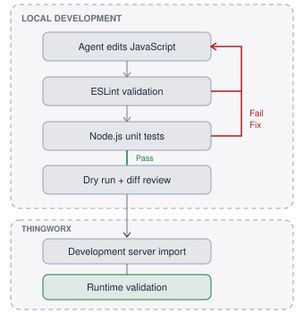

One of the features I was most excited to explore in ThingWorx 10.2.1 was JSON source control. Not necessarily because of JSON itself, but because of what it enables.

For years, bringing standard software engineering practices into ThingWorx development required additional tooling. Extracting JavaScript from XML exports, linting, unit testing and reviewing code changes were not always straightforward.

Now, with service implementations available as separate JavaScript files, things get much more interesting, especially when we bring AI coding agents into the development process.

I've been experimenting with this approach, combining JSON exports, MCP, ESLint and automated unit testing to see how far we can take it. [ThingWorx developer productivity overview](https://community.ptc.com/thingworx-developers-185/from-debugging-to-source-control-the-evolution-of-thingworx-developer-productivity-176239)

## From entities to source code

Here’s a simplified example of the folder layout I work with.

```text
twx-source/
  MyProject/
    Things/
      MyProject.Pump/
        MyProject.Pump.json          # the entity: properties, service list
        Services/
          StartPump.mp.json          # parameters, result type
          StartPump.mp.js            # the script, as a plain file
        Subscriptions/
          Event.Fault.mp.json
          Event.Fault.mp.js
```

The service script lives in a plain `.mp.js` file. Its parameters and result type live beside it in a small `.mp.json` file.

## Why separate `.js` files help coding agents

- **Edits are easier to review.** When the agent changes one `.mp.js` file, I can review the JavaScript diff directly.
- **Standard tools can read the script.** A JavaScript parser or linter can work on the file directly.
- **Context stays small.** The agent can start with the service script and open the descriptor when it needs the signature.

## Giving agents quality gates

As part of my experiments, I've extended the agent's capabilities with custom MCP tooling. One of the principles behind this implementation is that agents should follow the same quality gates we expect from developers.

For example, my `deploy_entity` tool blocks deployment when linting fails. The agent needs to fix the problem before it can move forward.

## Testing without deploying

My test harness loads the script in Node.js and supplies mocks for ThingWorx objects such as `me`, `Things` and `logger`. I keep unit tests alongside the source tree and have the agent run the suite after each change.

The agent follows the same sequence for each change.



The edit, lint and test cycle runs locally. The deployment step brings ThingWorx back into the loop.

## Where ThingWorx comes back into the loop

I use a source-control import to apply the edited files. After reviewing the dry-run diff, I import the change into a disposable development server and check how the service behaves with real ThingWorx objects. The Node.js tests give me fast feedback on the script’s logic, and the live check catches assumptions I got wrong in the mocks.

## Try it

If your ThingWorx instance supports JSON source-control export, open one exported service script in your editor. Ask an agent to add a parameter check and a unit test, then have it run both the linter and the test. Review the Git diff and the test result before importing the change into a development instance.

Service implementation is only one piece of the puzzle. What about entity creation, Mashup development or even entire ThingWorx applications?

That's what I'm exploring next.
